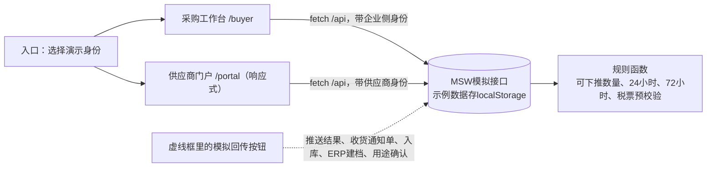
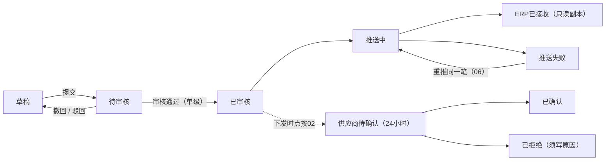

# 强盛SRM前端原型设计说明

> 更新日期：2026-10-15。
>
> 本文说明`09-产品原型`做成什么样：信息架构、菜单、页面清单、原型状态、权限矩阵和风格规范。业务依据是[01-全局背景信息](../01-全局背景信息/)，以分支`cursor/srm-global-background-2fd3`的提交`ac7b239`为准。
>
> 原型不是`04-产品设计方案`。字段、状态机、校验和接口的定稿以后放在04。04建立后，原型和04不一致的地方记在本文第十一节，不改04去迁就原型。
>
> 原型里的公司、SKU、价格、数量和日期都是**示例数据**，不代表强盛的事实。背景没有给出的家数、比例、账期、容差、人数、重试次数和接口行为，原型不填，按【待确认】编号标出。

下文用《n》指`01-全局背景信息`里序号为n的文件，用「n」或「待确认-n」指【待确认-n】，用A01至A15指待对齐事项第一、二节的编号。

| 简称 | 文件 |
| --- | --- |
| 《1》至《3》 | [公司业务背景](../01-全局背景信息/1.强盛科技公司业务背景信息.md)、[项目背景](../01-全局背景信息/2.强盛科技SRM项目的背景信息.md)、[定义和上下游链路](../01-全局背景信息/3.强盛SRM的定义和上下游链路.md) |
| 《4》至《6》 | [全局业务规则与约束](../01-全局背景信息/4.强盛SRM全局业务规则与约束.md)、[单据目录与分层](../01-全局背景信息/5.强盛SRM的单据目录与分层.md)、[编码规则](../01-全局背景信息/6.强盛SRM的编码规则和通用字段规则.md) |
| 《7》至《9》 | [分类分级与绩效口径](../01-全局背景信息/7.供应商分类分级与绩效口径.md)、[合规与审计要求](../01-全局背景信息/8.合规与审计要求.md)、[阶段规划与一期交付标准](../01-全局背景信息/9.阶段规划与一期交付标准.md) |
| 《10》《11》 | [术语表](../01-全局背景信息/10.术语表.md)、[待对齐事项](../01-全局背景信息/11.待对齐事项.md) |

---

## 一、原型要回答什么

原型只回答一件事：01写下的分工和规则落到两个入口之后，能不能点通，会不会写拧。检验用《9》里的场景：

| 场景 | 依据 | 在原型里怎么走 |
| --- | --- | --- |
| 缺料提前看见 | 《9》§2.1 | 采购员建单、审核、推送ERP；供应商24小时内确认或提交交期建议；齐套登记缺料，进入交付预警。建议已接受、ERP未更新时，订单显示「SRM已接受、ERP尚未更新」 |
| 一个外箱追回工厂和批次 | 《9》§2.2 | 箱码追溯页输入有效码和作废码 |
| 分两次到货，第二次没收齐 | 《9》§2.3 | 一张订单两张发货单；模拟ERP生成通知单，模拟WMS全收、缺量、零收 |
| 未上线的工厂由采购代录 | 《9》§2.4 | 未开通门户的供应商，由采购代录确认和发货，日志里有代录人、时间和依据 |
| 抽一张入库单追到税票 | 《9》§3.2 | 追溯页从采购入库单号查到对账单、开票申请、20位税票和红字记录 |
| 直播短周期交付 | 《9》§3.1 | 不做。备料单据见「11」 |

演示只证明流程表达，不证明ERP、WMS、金蝶和税务平台已经接通（《9》§四）。ERP和WMS的回传由「模拟回传」按钮触发。这些按钮放在虚线框里，和业务按钮分开。

---

## 二、技术栈和目录

| 用途 | 选型 |
| --- | --- |
| 框架 | React 19、TypeScript、Vite |
| 组件和主题 | Mantine 9：core、dates、form、notifications、charts（图表底层是Recharts） |
| 表格 | 列表用mantine-datatable 9。采购订单行这类可编辑表格，用TanStack Table v9自己封装 |
| 路由 | React Router 7，Hash路由，静态托管时深链接也能直接打开。8.x要求Node 22.22以上，原型从Node 22.12起步，先用7 |
| 服务端状态 | TanStack Query |
| 客户端状态 | Zustand，存演示身份和原型配置 |
| 模拟接口 | MSW 3，在浏览器里拦截`/api/*`。示例数据存在localStorage，可一键重置 |
| 图标 | Tabler Icons |

不用shadcn、Tailwind、Radix、Ant Design、daisyUI。

```text
09-产品原型/
├── 前端设计说明.md      本文
├── README.md           启动方式、入口、页面清单
├── AGENTS.md           原型目录的修改规则
├── package.json        依赖和脚本；node_modules、dist不提交
└── src/
    ├── main.tsx        先启动MSW，再渲染
    ├── app/            Provider、路由、两套布局
    ├── theme/          Mantine主题和全局样式
    ├── domain/         类型、状态文案、格式化、权限、待确认索引
    ├── mocks/          MSW接口、示例数据、规则函数、模拟回传
    ├── api/            请求封装和Query hooks
    ├── stores/         演示身份、原型配置
    ├── components/     通用组件：待确认标记、状态徽标、Code-Name、追溯链等
    ├── buyer/          采购工作台页面
    └── portal/         供应商门户页面
```

---

## 三、信息架构



- 同一个项目有两个入口。入口页选择演示身份：企业侧选角色，供应商侧选公司和账号。
- 身份通过请求头传给模拟接口。供应商身份的请求一律按本公司过滤。改URL访问别家的单据，接口返回403，页面显示「无权查看」。
- 页面不直接读示例数据，只走`/api`。规则在模拟接口里执行，页面上的置灰和提示只是提前告知，绕过页面直接调接口同样会被拒绝。
- 对象之间的追溯关系沿用《5》§四：税票、红字记录 → 开票申请 → 对账单 → 采购入库单或采退出库单 → 采购收货通知单 → 发货单和箱码 → SRM采购订单 → ERP采购订单。金蝶凭证和银行流水不在门户，追溯链上只写明「在金蝶」，不画假节点。

---

## 四、菜单

### 4.1 采购工作台

左侧导航，按分组展开。企业侧所有角色看到同一套菜单，能点哪些按钮按第七节控制。菜单上的数字是待办数。

| 分组 | 菜单 | 路由 |
| --- | --- | --- |
| 工作台 | 我的待办 | `/buyer` |
| 采购订单 | 采购订单 | `/buyer/orders` |
| | 审核中心 | `/buyer/approvals` |
| | 订单变更 | `/buyer/changes` |
| | 交期建议 | `/buyer/suggestions` |
| | ERP推送监控 | `/buyer/erp-sync` |
| 交付协同 | 发货单 | `/buyer/shipments` |
| | 预约看板 | `/buyer/appointments` |
| | 收货结果 | `/buyer/receipts` |
| | 交付预警 | `/buyer/alerts` |
| | 箱码追溯 | `/buyer/trace` |
| 对账与发票 | 对账单 | `/buyer/reconciliations` |
| | 开票申请 | `/buyer/invoice-requests` |
| | 税票登记 | `/buyer/invoices` |
| | 红字确认 | `/buyer/red-letters` |
| 供应商 | 供应商档案 | `/buyer/suppliers` |
| | 供应商准入 | `/buyer/admissions` |
| | 绩效看板 | `/buyer/performance` |
| 系统 | 操作日志 | `/buyer/audit-logs` |
| | 原型配置 | `/buyer/prototype-settings` |

### 4.2 供应商门户

| 宽屏顶部导航 | 手机底部标签 |
| --- | --- |
| 首页、采购订单、发货单、预约送货、收货与退货、对账、开票、红字确认、账户 | 首页、订单、发货、对账、更多。「更多」里是预约送货、收货与退货、开票、红字确认、账户和切换身份 |

---

## 五、页面清单

### 5.1 公共

| 编号 | 页面 | 路由 | 内容 |
| --- | --- | --- | --- |
| C01 | 入口 | `/` | 两张入口卡片，各自选择演示身份 |
| C02 | 无权查看 | 越权时就地显示 | 说明数据只属于本公司 |
| C03 | 页面不存在 | 其余路由 | 返回入口 |

### 5.2 采购工作台

| 编号 | 页面 | 路由 | 主要内容和动作 | 依据 |
| --- | --- | --- | --- | --- |
| B01 | 我的待办 | `/buyer` | 按角色显示待办卡片：待审核、推送失败、超24小时未确认、交期建议、供应商拒绝、交付预警、对账差异、待确认预约、红字待我方确认；最近操作 | 《2》§1.2 |
| B02 | 采购订单列表 | `/buyer/orders` | 多维状态筛选（多选）；推送失败、超时、建议待处理、代录、预警标记 | 《4》§一 |
| B03 | 新建采购订单 | `/buyer/orders/new` | 选供应商、收货仓、承诺交期；订单行用TanStack Table编辑，单价取ERP价目表快照只读；保存草稿、提交审核 | 《1》§六、《7》§四、「43」 |
| B04 | 编辑草稿 | `/buyer/orders/:id/edit` | 同B03，仅草稿可进 | |
| B05 | 采购订单详情 | `/buyer/orders/:id` | 单头、ERP只读副本、待生效变更提示；页签：明细、确认与交期、变更、发货与收货、ERP推送、操作日志、追溯。动作：提交、撤回、审核、驳回、重推、核对、发起变更、关闭取消（「04」）、代录 | 《3》§3.1、《9》§2.1 |
| B06 | 发起变更 | `/buyer/orders/:id/change` | 填变更后的值和原因；可改字段按「03」开关 | 《4》§一、「03」 |
| B07 | 审核中心 | `/buyer/approvals` | 待审核订单、待审核变更；单级审核，不禁止本人审核 | 《4》§四、「41」 |
| B08 | 订单变更列表 | `/buyer/changes` | 变更的审核和推送状态 | 《10》 |
| B09 | 变更详情 | `/buyer/changes/:id` | 前后值、来源建议、推送记录；审核、驳回、重推、作废草稿 | |
| B10 | 交期建议 | `/buyer/suggestions` | 接受（生成变更并推送）、驳回（填原因）；同一订单可有多条 | 《5》§三 |
| B11 | ERP推送监控 | `/buyer/erp-sync` | 订单、变更、发货单的推送记录；重推同一笔；核对七项 | A02、「06」 |
| B12 | 发货单列表 | `/buyer/shipments` | SRM状态和ERP回传分两列 | 《5》§五 |
| B13 | 发货单详情 | `/buyer/shipments/:id` | 发货行、箱码、预约、ERP通知单和入库；模拟ERP生成通知单、模拟WMS收货 | 《4》§二 |
| B14 | 代录发货 | `/buyer/shipments/new` | 只对未开通门户的供应商；表单同P05，另填代录依据 | 《9》§2.4 |
| B15 | 预约看板 | `/buyer/appointments` | 按日期和仓库看预约；仓储确认或退回改约 | 「24」 |
| B16 | 收货结果 | `/buyer/receipts` | 页签：入库回传（通知单、入库单、缺量、零收）；采购退货（CGTH、CTFHTZ、CTCK） | 《5》§三 |
| B17 | 交付预警 | `/buyer/alerts` | 距承诺交期N天且齐套未完成、已逾期、超24小时未确认；只提醒 | 《3》§3.2 |
| B18 | 箱码追溯 | `/buyer/trace` | 输入箱码或采购入库单号，展示追溯链；作废码醒目提示 | 《9》§2.2、§3.2 |
| B19 | 对账单列表 | `/buyer/reconciliations` | 按供应商和期间取ERP已审核入库、采退生成对账单 | 《4》§六、「16」 |
| B20 | 对账单详情 | `/buyer/reconciliations/:id` | 行全部只读；发送、处理差异（重新取数或说明后重发）、取消（「16」） | A07 |
| B21 | 开票申请 | `/buyer/invoice-requests` | 从已确认对账生成；列表看登记和预校验 | 《4》§六 |
| B22 | 开票申请详情 | `/buyer/invoice-requests/:id` | 应开金额和税额、已登记税票、预校验结果 | 《8》§四 |
| B23 | 税票登记 | `/buyer/invoices` | 蓝字、红字税票；用途确认状态只读（演示可切换） | 「14」「37」 |
| B24 | 红字确认 | `/buyer/red-letters` | 直接开红字和红字确认单两条路径；购买方发起、确认；72小时作废 | 《8》§四 |
| B25 | 供应商档案 | `/buyer/suppliers` | 编码和名称来自ERP；分级、门户开通状态 | 《6》§二 |
| B26 | 供应商详情 | `/buyer/suppliers/:code` | 基本信息只读；联系人和地址可维护；分级调整（暂停或待淘汰须填原因）；门户账号；日志 | 《3》§3.6、《7》§二 |
| B27 | 供应商准入 | `/buyer/admissions` | 准入资料收集和审查留痕 | 《4》§一、「13」「32」 |
| B28 | 准入详情 | `/buyer/admissions/:id`、`/buyer/admissions/new` | 登记资料、提交审查、审查意见、提交ERP建档、模拟ERP建档回传SUP编码 | 《8》§五 |
| B29 | 绩效看板 | `/buyer/performance` | 《7》§三的口径草案，示例数据计算；「33」的口径切换只用于对照 | 《7》§三 |
| B30 | 操作日志 | `/buyer/audit-logs` | 只追加、只读；筛选代录 | 《4》§五 |
| B31 | 原型配置 | `/buyer/prototype-settings` | 待确认开关、模拟ERP接口状态、重置示例数据 | 第九节 |

### 5.3 供应商门户

| 编号 | 页面 | 路由 | 主要内容和动作 | 依据 |
| --- | --- | --- | --- | --- |
| P01 | 首页 | `/portal` | 待办卡片：待确认订单（24小时倒计时）、待发货、待预约、待确认对账、待开票、红字待我方确认、退货待确认 | 《4》§三 |
| P02 | 采购订单 | `/portal/orders` | 本公司订单；手机上是卡片列表 | 《4》§四 |
| P03 | 订单详情 | `/portal/orders/:id` | 数量和价格只读；确认接单、拒绝（填原因）、提交交期建议、齐套反馈；变更待生效提示 | 《3》§3.1、§3.2 |
| P04 | 发货单 | `/portal/shipments` | 草稿、已提交、已取消；ERP回传只读 | 《5》§五 |
| P05 | 新建发货单 | `/portal/shipments/new` | 分步：选订单、填数量和供应商批号、装箱、物流、提交；本次可发数量实时校验 | 《4》§二、《6》§三 |
| P06 | 发货单详情 | `/portal/shipments/:id` | 箱码列表；补打、作废并换码；取消（「42」）；去预约 | 《6》§三 |
| P07 | 箱码打印 | `/portal/shipments/:id/labels` | 打印预览；条码区按「23」占位。代录时从B13进入`/buyer/shipments/:id/labels` | 《6》§三 |
| P08 | 预约送货 | `/portal/appointments` | 选发货单、日期、时段、车牌、件数；改约、取消 | 《3》§3.3、「21」「24」 |
| P09 | 收货与退货 | `/portal/receipts` | 经ERP回传的入库结果；退货确认知悉 | 《3》§3.4 |
| P10 | 对账单 | `/portal/reconciliations` | 待确认、有差异、已确认 | 《4》§六 |
| P11 | 对账单详情 | `/portal/reconciliations/:id` | 只读明细；确认无误、提出差异（选行、写原因） | A07 |
| P12 | 开票 | `/portal/invoicing` | 开票申请和已登记税票；登记数电票（20位号码），即时预校验 | 《8》§四 |
| P13 | 红字确认 | `/portal/red-letters` | 直接登记红字、发起或确认红字确认单、登记红字号码 | 《8》§四 |
| P14 | 账户 | `/portal/account` | 公司信息只读；联系人、送货地址可维护；子账号按「34」占位 | 《3》§3.6 |

---

## 六、原型状态

《5》不设状态机，状态机属于04。下面是原型为了能点通而设的演示状态，不是定稿。设计时守住两条：发货单的任何状态都不表示「仓库已按门户指令收货」（《5》§五）；承诺交期只在推送成功之后变化（《10》）。

### 6.1 SRM采购订单

订单状态拆成几个独立维度，不合成一条长链，避免把ERP的执行结果写进门户自己的状态机（《4》§七）。

| 维度 | 取值 | 怎么变 |
| --- | --- | --- |
| 审核 | 草稿 → 待审核 → 已审核。撤回、驳回回到草稿，驳回须填意见 | 单级审核，不禁止本人审核。《4》§四没有把「必须另一人审核」写成已生效，也不建多级审批和会签 |
| ERP推送 | 未推送 → 推送中 → ERP已接收 / 推送失败。失败后重推同一笔 | ERP单号按「05」开关生成；重推按「06」开关 |
| 供应商确认 | 未下发 → 待确认 → 已确认 / 已拒绝 | 下发时点按「02」开关。超过24小时只标红「超24小时未确认」，不自动确认（《4》§三） |
| 执行 | 执行中 → 已关闭 / 已取消 | 发起方见「04」，默认按钮置灰。已有入库的不能取消；全部入库不自动关单 |
| 收货（ERP回传，只读） | 未入库 / 部分入库 / 全部入库 | 来自采购入库单 |

另有四个标记，不算状态：交期建议待处理、SRM已接受且ERP尚未更新、代录、交付预警。



订单行上的数量口径，和ERP采购订单的字段同名：

| 数量 | 算法 | 来源 |
| --- | --- | --- |
| 累计入库数量 | 已审核采购入库单之和 | ERP回传 |
| 在途通知数量 | 已下发WMS、尚无最终结果的通知单之和 | ERP回传 |
| 可下推数量 | 采购数量 − 累计入库 − 在途通知。缺量和零收会把差额还回来 | ERP口径 |
| 已提交未生成通知 | 已提交、ERP还没生成通知单的发货数量 | 门户 |
| 本次可发 | 可下推数量 − 已提交未生成通知 | 门户校验用，不设容差 |

### 6.2 其他对象

| 对象 | 演示状态 | 说明 |
| --- | --- | --- |
| 订单变更 | 草稿 → 待审核 → 推送中 → 已生效；推送失败可重推；驳回为终态；草稿可作废 | 要不要审核按「41」开关。一张订单同时只允许一笔未完成的变更（原型约束）。变更编号写作「订单号·变更#n」，不另起前缀 |
| 交期建议 | 待处理 → 已接受 / 已驳回 | 接受即生成变更并提交。多条建议可以并存（《5》§三） |
| 齐套记录 | 已齐套 / 缺料，可追加多条；品质可写复核意见 | 节点名称先自由填写，清单见「20」 |
| 发货单（SRM） | 草稿 → 已提交；已提交且ERP未生成通知单时可取消 | 取消规则见「42」 |
| 发货单（ERP回传，只读） | 待ERP生成通知单 → 已下发WMS → 已入库（全收）/ 已入库（缺量）/ 零收取消 | 一张发货单对应一张通知单、一次最终结果（《5》§三） |
| 箱码 | 有效 / 已作废；记录打印次数 | 作废码不能再收 |
| 预约送货 | 待仓库确认 → 已确认；退回改约；已取消 | 「24」开关为否时提交即已预约。爽约不计算，见「24」 |
| 退货协同 | ERP退货链状态只读；供应商：待确认 → 已确认知悉 | 补货、扣款不在门户决定（「10」） |
| 对账单 | 已取数 → 待供应商确认 → 已确认 / 有差异；有差异由企业侧处理后重新发送；已取消 | 取消按「16」开关 |
| 开票申请 | 待开票 → 已登记税票；全额红冲后回到待重开 | 一张申请先对应一张蓝字税票，组合规则见「18」 |
| 税票 | 蓝字 / 红字；预校验：一致 / 有差额 | 容差未设定时只提示差额（「17」） |
| 红字确认单 | 待对方确认（72小时）→ 已确认 → 已开具红字；超72小时显示已作废 | 直接开红字的路径没有确认单，只登记红字号码 |
| 供应商准入 | 草稿 → 资料审查中 → 待ERP建档 → 已建档；退回补充回到草稿；已终止 | 准入资格的源头不在门户（《4》§一）。不生成「合格」（《8》§三） |
| 供应商分级 | 参股核心 / 未分级 / 暂停或待淘汰；「合格」不可选 | 暂停须填原因，标准见「32」 |

---

## 七、权限矩阵

角色名称没有定（「34」），组织架构也不映射角色（《4》§四）。原型按职责给出演示角色，名字都带「示例」，不对应文档里的具体人物。

| 动作 | 采购员 | 财务 | 仓储 | 品质 | 计划 | 系统管理 | 供应商用户 |
| --- | --- | --- | --- | --- | --- | --- | --- |
| 查看企业侧页面 | ✓ | ✓ | ✓ | ✓ | ✓（只读） | ✓ | |
| 新建、编辑、提交、撤回采购订单 | ✓ | | | | | | |
| 审核、驳回采购订单和变更（不禁止本人审核） | ✓ | | | | | | |
| 重推、核对ERP | ✓ | | | | | | |
| 发起订单变更；接受、驳回交期建议 | ✓ | | | | | | |
| 关闭、取消订单（「04」开关打开后） | ✓ | | | | | | |
| 代录确认、拒绝、发货、预约 | ✓（仅未开通门户的供应商） | | | | | | |
| 确认、拒绝接单；交期建议；齐套反馈 | | | | | | | ✓ |
| 复核齐套 | | | | ✓ | | | |
| 发货单、装箱、打印、补打、作废换码、取消 | 代录 | | | | | | ✓ |
| 预约送货、改约、取消 | 代录 | | | | | | ✓ |
| 确认预约、退回改约 | | | ✓ | | | | |
| 退货确认知悉 | | | | | | | ✓ |
| 生成、发送对账单 | ✓ | ✓ | | | | | 「16」开关含供应商时 |
| 确认对账、提出差异 | | | | | | | ✓ |
| 处理对账差异、取消对账单 | ✓ | ✓ | | | | | |
| 生成开票申请 | | ✓ | | | | | |
| 登记蓝字、红字税票 | | | | | | | ✓ |
| 发起、确认红字确认单 | | ✓（购买方） | | | | | ✓（销售方） |
| 维护联系人、送货地址 | ✓ | | | | | | ✓（本公司） |
| 调整供应商分级 | ✓ | | | | | | |
| 准入资料登记、提交审查 | ✓ | | | | | | |
| 准入审查意见 | ✓ | | | ✓ | | | |
| 开通门户账号 | | | | | | ✓ | |

- **数据范围。** 供应商用户只看本公司的订单、发货、对账和税票，参股核心厂也一样（《4》§四）。企业侧默认看全部供应商；「34」开关设为按人分管时，采购员只看分管的供应商。
- **代录。** 只对门户未开通的供应商出现。代录依据必填，日志记代录人、时间和依据。数量、关闭、超量校验和供应商自己操作相同，不能改价（《9》§2.4）。
- **原型配置**对所有企业侧演示身份开放。它是演示工具，不是业务权限，不进入上表。

---

## 八、规则落到界面

| 规则 | 界面怎么守 | 依据 |
| --- | --- | --- |
| 订单在SRM创建并审核，ERP只读 | 只有工作台能新建订单。ERP单号和ERP副本区块只读，标「ERP只读副本」 | 《4》§一 |
| 一张对一张，失败重试同一笔 | 重推沿用原SRM订单，推送记录按次追加；不提供「复制成新单再推」 | 《4》§一、《6》§四 |
| 核对七项 | 「核对ERP」逐项比对单号、供应商、行、数量、价格、交期、关闭状态，列出差异 | 《3》§3.1 |
| 承诺交期只在推送成功后变 | 变更已接受、ERP未更新时，订单头同时显示当前有效交期和「SRM已接受、ERP尚未更新」的新日期 | 《9》§2.1 |
| 24小时确认，不自动确认，不带条件接受 | 门户显示剩余时间；超时标红，仍要供应商自己操作；确认弹窗只有「按订单接单」；拒绝必须写原因 | 《4》§三、「19」 |
| 供应商不能改数量和价格 | 门户订单页全部只读，数量和单价旁有锁形提示；接口拒绝供应商改值。对数量或价格有异议，只能拒绝并写原因 | 任务要求；带条件接受未允许（《4》§三） |
| 单价取ERP价格快照 | 新建订单时单价、税率只读；取不到价格的SKU不能加入订单 | 《7》§四、「43」 |
| 发货数量不超过ERP可下推，不设容差 | 发货行显示可下推、已提交未生成通知、本次可发；超出时输入框报错，接口也拒绝 | 《4》§二 |
| 已关闭订单不能发货 | 发货入口置灰并写原因 | 《3》§3.1 |
| 一批发货一张通知、一次最终结果 | 发货详情分「SRM发货单」和「ERP回传（只读）」两块；模拟回传只有全收、缺量、零收，填超量被拒 | 《4》§二、《5》§三 |
| 发货单不是收货指令 | 发货单状态只有草稿、已提交、已取消；收货结果只看ERP通知单和入库单 | 《5》§五 |
| 零收不生成入库单 | 零收后通知单显示已取消，收货结果里不出现0数量入库 | 《5》§三 |
| 箱码数量之和等于发货数量 | 只填每箱数量，系统算整箱和尾箱，尾数单独成一箱，一箱一种SKU | 《6》§三 |
| 提交前可重打，提交后补打留次数，贴错作废换码 | 提交前「重新装箱」；提交后「补打」「作废并换码」；作废码在追溯里显示作废 | 《6》§三 |
| 供应商批号不是ERP库存批次 | 字段名写「供应商批号」，旁注A13 | A13 |
| 对账只取ERP已审核入库和采退，不能改值 | 对账行全部只读；供应商只能确认或提出差异，差异退回企业侧 | 《4》§六、A07 |
| 对账确认之后才开票 | 开票申请只能从已确认的对账单生成 | 《4》§六 |
| SRM不建应付、不付款 | 开票页写明应付、核销、付款在金蝶，门户只做预校验 | 《3》§3.5 |
| 数电票20位，无发票代码 | 号码按20位数字校验；发票代码只作为纸票兼容的选填项 | 《6》§四、《8》§四 |
| 红字分两条路径 | 未用途确认且未入账确认：直接登记红字；已确认：先走红字确认单，72小时未确认显示作废 | 《8》§四 |
| 查重只在门户内 | 预校验写明「门户内查重」；真伪查验显示未接入 | 《6》§四、「37」 |
| 供应商隔离 | 接口按请求头里的供应商过滤；越权访问显示「无权查看」 | 《4》§四 |
| 留痕 | 关键动作记操作者、时间、对象和前后值；日志只读，没有删除 | 《4》§五、《8》§二 |
| 暂停或待淘汰不接新订单 | 新建订单的供应商下拉里置灰并写原因；在途、退货、对账照常 | 《7》§二 |
| 不生成「合格」 | 分级里「合格」不可选 | 《8》§三、「32」 |
| 供货范围不限制下单 | 新建订单可以选任意SKU | A09、「40」 |
| 门户不发供应商编码 | 准入通过后等ERP建档回传SUP编码 | 《6》§二 |
| 采购订单号前缀未定 | 单号用「待定」占位，不印CGDD或建议前缀 | 《6》§1.1、「05」 |
| 建议前缀只是演示 | FHD、YYSH、JYJS、DZD、KPSQ单号旁标「建议前缀·演示」 | 《6》§1.3 |
| 登录名不用供应商编码 | 演示账号用独立登录名 | 《6》§二、「34」 |
| 预警只提醒 | 预警页不提供改单、关单动作 | 《3》§3.2 |
| 绩效不拦截下单、不出配额 | 看板注明口径草案，不和下单联动 | 《7》§三 |

---

## 九、【待确认】怎么处理

### 9.1 标记方式

- 页面上用琥珀色虚线标记「待确认-n」。悬停时显示待对齐事项里这一条的原文。原文在构建时直接读[11.待对齐事项.md](../01-全局背景信息/11.待对齐事项.md)，不在代码里另抄一份；编号不在索引里时，标记变红，提示先补索引。
- 能用开关表达的，放进原型配置（9.2）。开关的默认值是原型为了能演示而选的，不是结论，每个开关旁边都写着编号。
- 不能用开关表达的，只做占位（9.3），不替强盛做决定。

### 9.2 原型配置开关

切换只影响之后的操作，不改写已有示例数据。想从头演示，可以重置示例数据。

| 编号 | 开关 | 选项 | 原型默认 | 影响 |
| --- | --- | --- | --- | --- |
| 02 | 下发供应商的时点 | 审核通过即下发，同时推送 / ERP接收成功后才下发 / 先请供应商确认，确认后才推送，拒绝的不推送 | 审核通过即下发 | 审核、推送、门户待确认 |
| 03 | 推送后可变更的字段 | 承诺交期常开；采购数量、含税单价、收货仓库各有开关 | 只开承诺交期 | 发起变更 |
| 03 | 变更生效后请供应商重新确认 | 是 / 否 | 否 | 变更生效后的确认状态 |
| 04 | 关闭、取消的发起方 | 未定（按钮置灰）/ 演示由SRM采购员发起 | 未定 | 订单详情 |
| 05 | ERP采购订单号 | ERP另编CGDD，SRM单号存为来源 / ERP沿用SRM单号 | 另编CGDD | 推送结果、核对 |
| 06 | 推送失败后的重推 | 采购员可手工重推 / 只允许系统自动重试 | 可手工重推 | 推送监控、订单详情。原型不模拟自动重试 |
| 16 | 对账发起方 | 企业侧 / 供应商 / 双方 | 企业侧 | 对账列表 |
| 16 | 已发送未开票的对账单能否取消 | 不允许 / 允许 | 不允许 | 对账详情 |
| 17 | 尾差容差 | 未设定 / 填一个金额 | 未设定 | 税票预校验未设定时只提示差额，不判定通过 |
| 19 | 未确认的订单能否发货 | 不允许 / 允许 | 不允许 | 新建发货单 |
| 24 | 预约须仓库人工确认 | 是 / 否 | 是 | 预约 |
| 34 | 采购员按人分管供应商 | 否 / 是 | 否 | 企业侧列表范围 |
| 41 | 订单变更须审核 | 是（单级）/ 否（提交即推送） | 是 | 变更、审核中心 |
| - | 交付预警提前天数 | 阶段4：10天 / 阶段5：7天 | 10天 | 预警。两档都写在《4》§三，不是待确认 |
| - | 模拟ERP接口状态 | 正常 / 不可用（推送都失败） | 正常 | 演示推送失败和重推 |

### 9.3 只做占位的

| 编号 | 原型里怎么出现 |
| --- | --- |
| 01 | 新建订单页注明「由采购员手工创建」，申请或计划来源见「01」 |
| 07 | 发货单按一张订单、一个收货仓填写，旁注「07」 |
| 09 | 收货结果里拒收、质检、箱码扫描列显示「-」，表头标「09」 |
| 10 | 模拟回传填超量时被拒，提示多出的货怎么处理见「10」；退货页注明补货、扣款不在门户决定 |
| 13 | 供应商档案注明来源为ERP；关联方标记显示「待认定」 |
| 14 | 开票申请的「推送金蝶」显示未定；红字确认单注明税务平台上的操作主体见「14」 |
| 15 | 开票申请的购买方旁注「15」 |
| 18 | 一张开票申请先登记一张蓝字税票，旁注「18」 |
| 20 | 齐套节点名称自由填写；品质复核记在门户，旁注「20」 |
| 21、22 | 收货仓下拉旁注「21」；东莞电商仓的箱码标签旁注「22」 |
| 23 | 箱码用内部流水的演示格式；标签上的条码区只占位，不画条码图形 |
| 25 | 供应商类别只列名称，不出现家数 |
| 26 | 参股核心旁注「不自动等于关联方」 |
| 28 | 供应商档案的账期显示「-」 |
| 32 | 「合格」不可选；资质类型自由填写；工商核验显示未接入 |
| 33 | 绩效看板可以切换首次或最终承诺交期、按批次或按数量，只用于对照，不是选定 |
| 35 | 准入页的样品准入显示未定；不做寻源和询报价 |
| 36 | 订单列表注明历史未结订单的迁入方式见「36」 |
| 37 | 预校验的真伪查验显示未接入 |
| 38 | README注明示例数据不是验收数据 |
| 40 | 新建订单页注明供货范围不限制下单 |
| 43 | 取不到ERP价格的SKU在选择框里置灰 |

### 9.4 本次新增的缺口

原型暴露了三个01里没有的事实，已先补进待对齐事项索引，再在原型里引用：

| 编号 | 缺的事实 | 原型怎么处理 |
| --- | --- | --- |
| 【待确认-41】 | 订单变更提交后要不要审核、由谁审核 | 开关，默认要审核，单级，和采购订单一致 |
| 【待确认-42】 | 发货单提交后能否取消；ERP已生成通知单后怎样联动 | ERP生成通知单之前允许取消；生成之后取消按钮置灰 |
| 【待确认-43】 | 取不到ERP有效采购价时能否在SRM录入 | 不能加入订单 |

---

## 十、风格规范

### 10.1 取向

ERP和WMS原型是shadcn加Tailwind，JXC是手写Tailwind组件。SRM用Mantine自己的主题体系，做一套「清爽、偏冷、数据密」的风格：青碧色主色，浅冷灰底，白色卡片，细边框，少阴影，数字等宽对齐。工作台按桌面信息密度设计，门户按手机可点设计。

### 10.2 主题参数

| 项 | 取值 |
| --- | --- |
| 主色 | 自定义色板`jade`（青碧），10档：`#e8f7f3`、`#d3ede6`、`#a7dbcd`、`#77c8b3`、`#4fb89d`、`#36ae90`、`#249d80`、`#0f846b`、`#06705b`、`#005c4a`。实心按钮用第7档，白字对比度4.63:1；浅色变体用第1档底、第9档字 |
| 底色和文字 | 页面底`#f4f6f8`，卡片白色，边框`#e3e8ee`，正文`#1b2733`，次要文字`#5b6b7b`（白底对比度5.48:1） |
| 圆角 | xs 4、sm 6、md 8（默认）、lg 12、xl 16。卡片lg，徽标sm |
| 字体 | 系统中文字体栈：PingFang SC、Microsoft YaHei、Noto Sans SC、WenQuanYi Micro Hei；单号和编码用等宽字体；数字用`tabular-nums` |
| 字号 | xs 12、sm 13、md 14、lg 16、xl 18；标题h1 22、h2 18、h3 16 |
| 间距 | xs 6、sm 10、md 14、lg 20、xl 28 |
| 密度 | 工作台：输入框和按钮默认sm，表格行距xs，字号13。门户手机端：输入框和按钮md，可点区域不小于44px |
| 语言和日期 | dayjs`zh-cn`，每周从周一开始；日期`YYYY-MM-DD`，时间`YYYY-MM-DD HH:mm`，一律北京时间 |

### 10.3 状态色

| 语义 | 颜色 | 例子 |
| --- | --- | --- |
| 草稿、中性 | gray | 草稿、未下发、未推送 |
| 等别人处理 | orange | 待审核、待确认、待仓库确认、待供应商确认 |
| 进行中 | blue | 推送中、执行中、已下发WMS |
| 完成、一致 | green | 已审核、ERP已接收、已确认、全部入库 |
| 失败、超时、差异 | red | 推送失败、超24小时未确认、有差异、已拒绝 |
| 终止 | dark | 已关闭、已取消、已作废、已终止 |
| 建议、变更 | violet | 交期建议待处理、变更待生效 |
| 代录 | cyan | 代录 |

主色青碧只用于品牌、主按钮和选中态，不当作状态色，避免和「完成」的绿色混淆。

### 10.4 标记

| 标记 | 样式 | 出现位置 |
| --- | --- | --- |
| 示例数据 | 紫色（grape）徽标；页头常驻一条示例数据提示 | 每一页 |
| 待确认-n | 琥珀色虚线徽标，悬停看原文 | 涉及待确认的字段、按钮和说明 |
| 模拟回传 | 虚线框，标题「模拟ERP/WMS回传（演示工具）」 | 推送、通知单、入库、建档、用途确认 |
| ERP只读 | 灰底区块，标题带锁形图标 | ERP单号、ERP副本、入库结果 |
| 建议前缀·演示 | 单号后的小号灰字 | FHD、YYSH、JYJS、DZD、KPSQ |

### 10.5 数据格式

沿用ERP已确认的展示口径：主数据引用用Code-Name，编码和名称之间一个空格；数量只用整数；单价4位小数，金额和税额2位小数，尾差计入税额；千分位；空值显示`-`；明细列顺序为含税单价、税率、不含税单价、价税合计、税额、金额。这是展示约束，门户不重算采购价格（《6》§二）。

### 10.6 响应式

| 断点 | 工作台 | 门户 |
| --- | --- | --- |
| ≥ 1200px | 左侧导航常驻 | 顶部导航，内容最宽1200px居中 |
| 768至1199px | 导航可收起 | 顶部导航折叠成菜单 |
| < 768px | 不专门适配 | 底部标签栏；列表变卡片；主要动作固定在底部操作栏；表单单列 |

---

## 十一、和已确认设计的差异、未做的部分

### 11.1 差异

| 原型做法 | 为什么这样做 | 以谁为准 |
| --- | --- | --- |
| 第六节的状态名称和跳转 | 原型要能点通 | 04建立后的状态机 |
| 单号、箱码、登录名的格式 | 前缀和码制未定，见「05」「23」「34」 | 《6》和后续确认 |
| 承诺交期只放在订单头 | 和ERP采购订单字段一致。行级交期01没有写 | 04 |
| 一张订单同时只允许一笔未完成的变更 | 避免两笔变更交叉推送 | 04 |
| 推送、通知单、入库、建档、用途确认由按钮模拟 | 没有真实接口 | ERP、WMS、金蝶和税务平台的联调记录 |

### 11.2 未做

- 真实登录、密码和短信；真实ERP、WMS、金蝶、税务平台接口；自动重试和自动关单。
- 附件只记录文件名，不保存文件；条码图形；导入导出；消息提醒。
- 01明确未定或不在范围的：采购申请和计划（「01」）、虚拟入库（「08」）、半成品备料（「11」）、委外供料（「12」）、费用单（「31」）、样品准入和询报价（「35」）、驻厂验货记录（「20」）、质量异常单、历史订单迁移（「36」）、直播快收。
- 暗色主题、多语言、并发冲突、大数据量性能、自动化测试。
